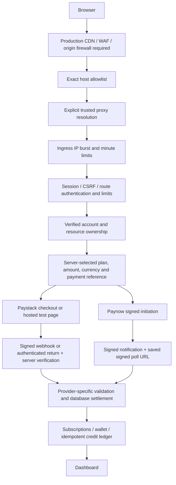

# Authentication, endpoint and payment audit — 27 October 2026

## Scope and result

Reviewed the current local Laravel checkout: routes, global/web middleware, authentication controllers and requests, email verification, ownership checks, Paystack hosted and API checkout, Paynow initiation/notifications/polling, shared payment settlement, credits, background jobs, dependency advisories and deployment checks. Automated tests use an in-memory database and mocked provider requests. No real charge or attack-volume traffic was generated.

This is a source review and local regression assessment, not a penetration-test certification or evidence of 14,000 requests/second capacity. Production infrastructure, DNS, edge rules, actual provider delivery and multi-worker database contention were not tested. Substantial unrelated modifications existed before this audit; the audit commit intentionally excludes them.

## Findings fixed

| Priority | Finding | Remediation |
| --- | --- | --- |
| High availability | Existing general web throttle ran after session startup. Rejected traffic could still load database sessions, and missing routes did not share an early route-independent budget. | Global ingress throttle after proxy processing and before routing/sessions: 60 requests/second and 600/minute per IP. Unknown paths share the same budget. Existing endpoint limits remain. |
| Medium availability | Login form and pricing GET requests shared only the broad site limit. | Shared 60/minute per-IP budget across login, register, forgotten/reset-password forms and pricing; changing paths does not reset this budget. POST identity/IP throttles remain separate. |
| Medium security | Composer reported Livewire authorization bypass GHSA-mhf7-xp6r-6qrc in installed 4.4.7. | Updated to 4.4.8 and compatible Symfony patch dependencies in composer.lock. |
| Medium availability | Valid signed Paynow notification could be replayed against a different local payment URL, causing an unrelated provider poll. This did not itself bypass signed polling or grant forged credits. | Check signature and bind the signed reference to the URL before loading the payment or polling. Reject bodies over 64 KiB. |
| Low availability | Nested Paynow fields could throw during signature calculation. | Reject non-scalar notification fields with a normal invalid-signature result. |
| Low availability | Login allowed arbitrarily long credential strings. | Email limited to 255 characters and password to 1,024 before authentication. |
| Deployment | Rate-limit storage followed the general cache store; a database-backed limiter can add load during floods. | Added independent CACHE_LIMITER configuration; deployment check now requires a Redis-backed shared rate-limit store. This local machine remains on database caching until Redis is provisioned. |
| Test isolation | Tests inherited local APP_URL and Google redirect settings, causing host and OAuth expectations to depend on the mobile development setup. | Explicit test-only localhost application URL and empty Google override. |

## Architecture and trust boundaries

Paystack uses ZAR merchant pricing, supports recurring subscriptions and receipt-level renewal/reversal handling. Its API checkout supplies a callback URL; externally hosted test pages store their redirect at Paystack. Paynow uses USD server prices and one-time payments, with no automatic renewal. Both converge on the same subscription/credit model; one successful payment must not be counted twice when browser returns and webhooks race.

Paystack verifies transaction reference, merchant mode, amount, currency, customer identity and applicable plan. Receipt uniqueness and user/payment database locks guard settlement. Hosted-page reconciliation additionally verifies the merchant page/plan and account email. Test credits are an explicit local-only exception; they must remain disabled in production.

Paynow validates signed provider responses, restricts polling/checkout hosts to HTTPS Paynow domains, disables redirect following, ignores incoming poll URLs, and polls only the signed URL stored at initiation. Poll results must match local reference, amount and stable provider reference. Settlement locks the user/payment, grants live access once and handles reversals. Test Paynow payments do not grant live subscriptions. Browser return URLs alone never establish payment success.

Authentication uses password hashing, session regeneration on login/signup/OAuth and invalidation on logout. Google OAuth state is consumed once and compared in constant time; verified provider email and subject checks gate login/linking. Reset responses avoid exposing account existence. Verification codes are hashed, expire after ten minutes and allow five wrong attempts, with per-user/IP/recipient send limits. Registration still reports an already registered email through validation; account enumeration via signup remains a product/security tradeoff.

Authenticated payment queries scope by owner; resume and analysis access checks reject other accounts. Paid/workspace routes require verified email. CSRF applies to browser mutations; provider webhook exceptions authenticate through provider signatures and subsequent verification instead. Existing host-header checks, restricted proxy trust, no-store private responses and basic response security headers remain. Current CSP does not enforce a strict script policy. No MFA or external abuse challenge was added.

## Request budgets

Limits are layered, not throughput guarantees. IP limits can affect shared-office/mobile NAT users and need tuning from real telemetry. Laravel fixed-window checks are not a strict distributed concurrency semaphore.

| Surface | Limits |
| --- | --- |
| All application requests reaching ingress | 60/second and 600/minute per IP, including unknown routes |
| Login/register/reset forms and pricing GET | Additional shared 60/minute per IP |
| Login POST | 20/minute and 100/hour per IP; 10/15 minutes per normalized email; five failed attempts per email/IP |
| Signup | 3/minute and 10/hour per IP |
| Reset email | 3/minute, 10/hour per IP; 3/hour and 5/day per email |
| Verification | Send: 1/minute per account plus IP/recipient budgets; check: 6/minute, 20/hour per account and 30/minute per IP |
| Authenticated workspace | 120/minute per account and 600/minute per IP |
| Checkout mutations | 6/minute route throttle plus workspace/general budgets |
| Payment returns | 20/minute per account and 60/minute per IP |
| Paynow notifications / Paystack webhooks | Existing 60/minute / 120/minute route throttle plus ingress limits and signature checks |
| AI, import and export | Existing account/IP budgets; paid AI operations also reserve credits |

## Required production protection against 14K requests/second

Application middleware runs inside PHP and cannot stop network saturation, connection exhaustion, TLS overhead, PHP bootstrap cost or request parsing before middleware. The development server is unsuitable for public production traffic. A rotating botnet can bypass per-IP budgets by spreading traffic across addresses.

1. Serve a canonical public HTTPS domain through a DDoS-capable CDN/WAF. Enable managed attack rules and endpoint-specific rate rules for authentication/pricing. Do not apply interactive browser challenges to payment webhooks; use provider-compatible filtering and signature verification.
2. Restrict origin HTTP/HTTPS ingress to the edge network (or use an authenticated tunnel). Block direct-origin bypass, database access and development/admin ports. Set the document root to public/ and deny secrets, repository and storage access.
3. Set production environment/debug/cookies correctly. Configure only actual trusted proxy addresses so forged forwarded headers cannot rotate client identities. Preserve real client IPs from the trusted edge. Configure shared Redis and CACHE_LIMITER=redis across workers with an application-specific cache prefix. Rate-store failure must not silently disable throttling.
4. Configure request-size/header/body/time/connection limits at the edge and web server, before PHP. Bound PHP workers and queues; monitor 429s, authentication failures, 5xx, Redis/database latency, queue lag and payment verification failures. Public HTML currently has session/CSRF/account-specific navigation: do not enable shared full-page caching without separating personalized content.
5. Configure canonical callback/return/webhook URLs in both providers. The current Paystack hosted test redirects use a private Wi-Fi address for development and must be changed for deployment. Paynow result notifications require a public reachable HTTPS endpoint; local Wi-Fi addresses cannot receive provider-server webhooks. SameSite=Lax permits browser GET returns; an alternate host or browser may require login again.
6. Use durable payment workers and retries with a heartbeat, scheduled reconciliation, appropriate retry-after/timeout settings, alerting and manual recovery. Paystack refresh can scan historical receipts and paginated customer transactions; its cost grows with history, so monitor/backlog-limit it and move large-account reconciliation to bounded scheduled batches before scale. Signed repeated callbacks still incur verification work; signature verification is not a replacement for edge budgets and queue controls.
7. Run app:deployment-check on the actual host, then run authorized staging load tests gradually. Test distributed source traffic, bursts, legitimate NAT users, provider webhook retries and concurrent return/webhook settlement. Set capacity/latency/availability targets and measure worker, database and Redis saturation. No 14K-RPS load test was performed here.

## Validation

- New AuditHardeningTest covers rejection before session startup, unknown-route budgets, shared public-page budgets with spoofed forwarding headers, Paynow nested fields, signed cross-reference replay, oversized notification bodies and oversized login credentials.
- Existing authentication, threat, billing and hosted Paystack tests cover CSRF, ownership, forged notifications, provider amount/reference checks, replay/idempotency, test/live separation and reversals.
- Composer and npm advisory scans were rerun after the Livewire patch.
- Focused authentication/security/billing/Paystack regression run: 88 tests passed, 515 assertions. Composer and npm report zero known advisories after updates; PHP platform checks and formatting checks pass.
- Full-suite run: 326 passed and one existing pricing-copy expectation failed (WorkspaceTest expects “7 selected CV templates”; the pre-existing working-tree plan component now says “Selected CV templates”). This unrelated product-copy assertion was not changed in the audit commit. It does not establish a payment or authentication failure.
- These are local/mocked checks. Provider sandbox end-to-end browser tests and concurrent MySQL settlement tests remain deployment validation tasks.

## Primary references

- [Livewire advisory](https://github.com/advisories/GHSA-mhf7-xp6r-6qrc)
- [Laravel rate limiting](https://laravel.com/docs/12.x/rate-limiting)
- [Paystack payment verification and callback flow](https://paystack.com/docs/payments/accept-payments/)
- [Paystack hosted payment page redirects](https://paystack.com/docs/api/page/)
- [Paynow status update verification](https://developers.paynow.co.zw/docs/paynow/status_update/)
- [Cloudflare origin protection](https://developers.cloudflare.com/fundamentals/security/protect-your-origin-server/)
